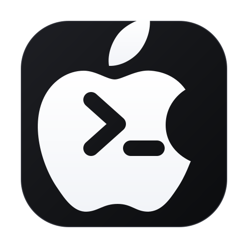

<p align="center">
  
</p>

<h1 align="center">iOS CLI</h1>

<p align="center">
  <strong>The Unified Apple Platform & iOS Development Suite for AI Coding Agents</strong>
</p>

<p align="center">
  <a href="LICENSE"></a>
  <a href="https://developer.apple.com/swift/"></a>
  <a href="https://developer.apple.com/xcode/"></a>
  <a href="#"></a>
  <a href="#"></a>
</p>

---

## 💡 Motivation & Background

Google set a high standard for agentic workflows with the official `android-cli`, unifying project creation, device emulation, layout inspection, and journey testing into a single tool for AI assistants.

In the Apple ecosystem, development workflows have historically remained fragmented between `xcodebuild`, `xcrun simctl`, custom scripts, complex code signing, and dispersed documentation.

**`iOS CLI`** bridges this gap. It provides a standardized, agent-first suite for Apple platform development (iOS, iPadOS, macOS, watchOS, visionOS). By unifying Apple's official Model Context Protocol (`mcpbridge`) and Sentry's `MobileBuildMCP` with 22 specialized skills and dedicated architectural subagents, `iOS CLI` transforms coding assistants into full-fledged **Senior/Principal Apple Platform Engineers**.

While initially built for **Google Antigravity**, `iOS CLI` is architected to cleanly support **Claude Code**, **Cursor**, **OpenAI Codex**, and any MCP-compliant coding environment.

---

## 🚀 Key Capabilities

### 📱 Fast Simulator Workflows & Incremental Builds
- Automatically discover Xcode workspaces, projects, schemes, and destinations without manual navigation.
- Boot, control, install, and execute apps on iOS Simulators via high-performance incremental builds with automatic DerivedData caching.

### 🔍 UI Layout Inspection & HitPoint Accuracy
- Extract structured element trees and UI bounds using runtime element snapshots.
- Compute precise **`hitPoint`** coordinates for reliable automated tap and gesture synthesis.
- Capture simulator screenshots (`screenshot`) and record demonstration videos (`record_sim_video`).

### 🧪 Journey Testing (End-to-End User Flows)
- Execute natural language multi-step user scenarios on live simulators.
- Verify intermediate UI states and generate structured Markdown test reports with milestone screenshots.

### 🎨 Component-Level SwiftUI Previews
- Render individual `#Preview` macros and `PreviewProvider` views directly via Apple's official `RenderPreview` tool.
- Visually test Light/Dark modes, Dynamic Type sizes, and localization overrides without building the full application.

### 🏛️ Lead Architect & System Design Mindset
- Audit codebase for **Swift 6 Strict Concurrency** (Actor boundaries, `@Sendable`, data-race prevention).
- Decompose monolithic applications into scalable **Local Swift Packages (SPM)** using Clean MVVM or The Composable Architecture (TCA).
- Design and safely migrate persistent databases using **SwiftData** (`VersionedSchema`, `SchemaMigrationPlan`).

### 🔍 Deep Runtime Debugging & Profiling
- Decipher symbolicated crash logs (`EXC_BAD_ACCESS`, `SIGABRT`, `0x8badf00d` Watchdog terminations).
- Execute interactive LLDB commands (`bt`, `po`, `frame variable`) via MCP.
- Eliminate retain cycles (`[weak self]`) and prevent 120Hz/60Hz main-thread hitches.

### ♿ Official Apple Accessibility Compliance
- Audit views against Apple's strict **Accessibility Nutrition Label** standards:
  - **VoiceOver:** Automated verification of element labels, traits, and rotor navigation.
  - **Dynamic Type:** Verification of font scaling, truncation, and layout wrapping.
  - **Contrast:** WCAG 2.1 compliance checking for Light and Dark modes.

---

## 👥 Dedicated Expert Subagents

| Subagent | Role & Specialty |
| :--- | :--- |
| **`ios_architect`** | **Lead Architect**: Evaluates project modularity (local SPM packages), enforces Swift 6 strict concurrency boundaries, applies Clean MVVM/TCA patterns, and isolates dependencies. |
| **`ios_debugger`** | **Performance & Systems Specialist**: Deciphers crash logs, executes LLDB commands via Xcode MCP, eliminates retain cycles (`[weak self]`), and prevents main-thread frame drops. |

---

## 📦 Bundled Skills Catalog (22 Skills)

### 🏛️ Architecture, Concurrency & Data
* **`ios-architecture-advisor`**: Modular SPM package design, TCA patterns, and Dependency Injection client structs.
* **`swiftdata-persistence-expert`**: SwiftData `@Model` schema design, `@ModelActor` concurrency, and safe `VersionedSchema` database migrations.
* **`swiftui-specialist`**: Apple authoritative guidelines for `@Observable`, state ownership, and view invalidation scoping.
* **`swiftui-whats-new-27`**: New SwiftUI APIs, swipe actions, and container reordering.
* **`building-document-based-swiftui-applications`**: Building document-centric apps with `DocumentGroup` and `FileWrapper`.
* **`uikit-app-modernization`**: Modernizing UIKit for multi-window environments and scenes.
* **`adopt-c-bounds-safety`**: Adopting Apple `-fbounds-safety` for C/C++ memory security.

### 🔍 Deep Debugging, Testing & Security
* **`ios-debugging-and-profiling`**: Investigating runtime crashes, LLDB command execution, and main-thread hitch elimination.
* **`modernize-tests`**: Swift Testing framework modernizations with `@Test` and `#expect`.
* **`audit-xcode-security-settings`**: Hardening Xcode compiler build settings and static analysis checkers.
* **`mobilebuildmcp`**: High-performance simulator workflows and session defaults.

### ♿ Accessibility & Localization (Apple Official Standards)
* **`accessibility-voiceover-specialist`**: Auditing views against Apple's VoiceOver accessibility criteria.
* **`accessibility-dynamic-type-specialist`**: Auditing Dynamic Type font scaling and layout truncation.
* **`accessibility-sufficient-contrast-specialist`**: Auditing WCAG color contrast ratios across Light and Dark modes.
* **`translation`**: Integrating the on-device Apple Translation framework.
* **`translation-coordinator`**: Multi-agent coordination for bulk localization and string catalogs.

### 📱 Simulator, UI Automation & Apple Ecosystem
* **`ios-cli`**: Master coordinator for Apple platform development workflows.
* **`ios-journey-testing`**: Natural language end-to-end user scenario testing with screenshots.
* **`swiftui-preview`**: Rapid SwiftUI `#Preview` rendering via Apple's official `RenderPreview` tool.
* **`device-interaction`**: Device and simulator interaction sessions with precise `hitPoint` touch synthesis.
* **`app-intents-specialist`**: Apple authoritative guidelines for App Intents, Siri, Shortcuts, and Spotlight indexing.
* **`app-intents-whats-new-27`**: New App Intents APIs (UndoableIntent, LongRunningIntent, etc.).

---

## ⚙️ Bundled MCP Servers (Zero-Config)

| Server | Provider | Command | Description |
| :--- | :--- | :--- | :--- |
| **`xcode`** | Apple Inc. | `xcrun mcpbridge` | Official Xcode integration: project files, builds, tests, LLDB, previews, documentation search. |
| **`mobile-build`** | Getsentry | `npx -y mobilebuildmcp mcp` | Fast simulator lifecycle management, incremental run/install, and UI element snapshots. |

*Zero-Config Portability: `mobilebuildmcp` executes via `npx -y`. On any machine with Node.js installed, `npx` automatically downloads and caches the required binary on first use.*

---

## 🛠️ Installation & Setup

### Prerequisites
* **macOS** with **Xcode 16+** and Command Line Tools installed (`xcode-select --install`).
* **Node.js 18+** (providing `npx` in your system `PATH`).

### Option 1: For Google Antigravity
Clone directly into your Antigravity global plugins directory:
```bash
git clone https://github.com/<your-username>/ios-cli.git ~/.gemini/config/plugins/ios-cli
```
Antigravity automatically detects and live-reloads the plugin. Manage or toggle it anytime via your Customizations page.

### Option 2: For Claude Code / Cursor / Other MCP Clients
Add the bundled MCP servers to your client's configuration (e.g., `~/.claude/mcp.json` or `~/.cursor/mcp.json`):
```json
{
  "mcpServers": {
    "xcode": {
      "command": "xcrun",
      "args": ["mcpbridge"]
    },
    "mobile-build": {
      "command": "npx",
      "args": ["-y", "mobilebuildmcp", "mcp"]
    }
  }
}
```

---

## 🤝 Contributing

Contributions from the Apple and AI developer community are warmly welcomed!
1. Fork the repository.
2. Create your feature branch (`git checkout -b feature/amazing-skill`).
3. Commit your changes (`git commit -m 'Add amazing skill'`).
4. Push to the branch (`git push origin feature/amazing-skill`).
5. Open a Pull Request.

---

## 📜 License

Distributed under the **MIT License**. See [`LICENSE`](LICENSE) for more information.
